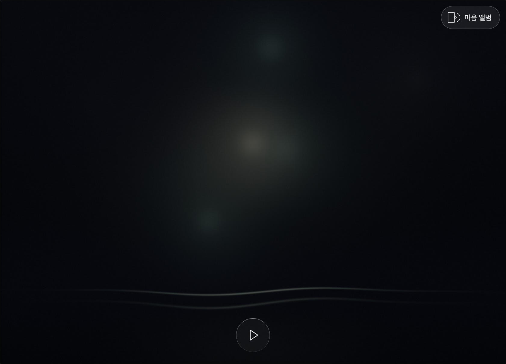
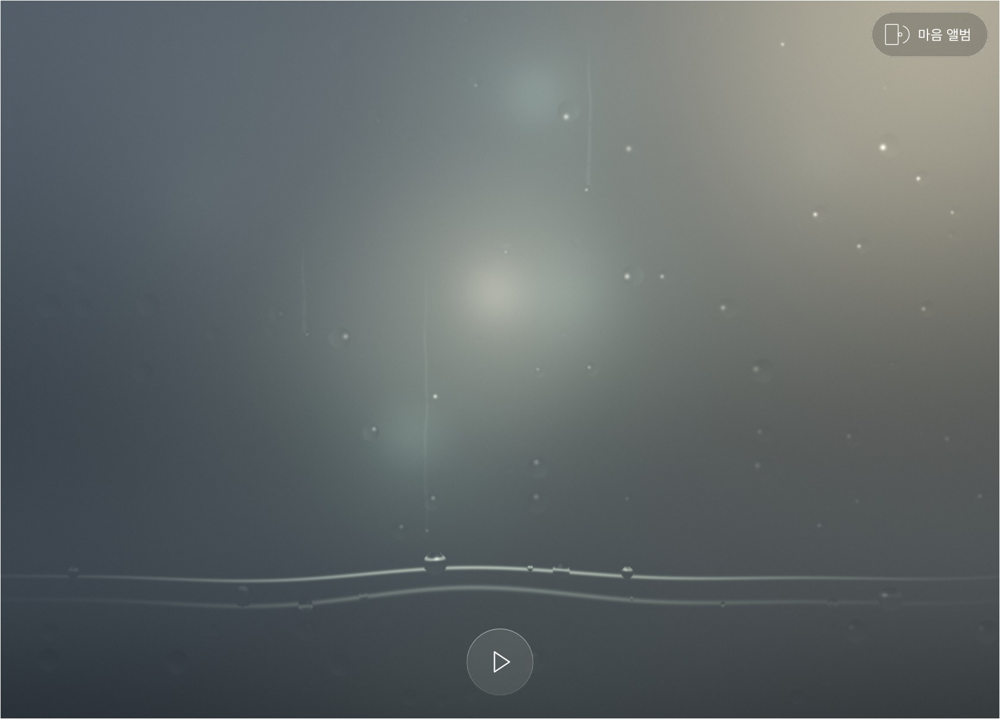
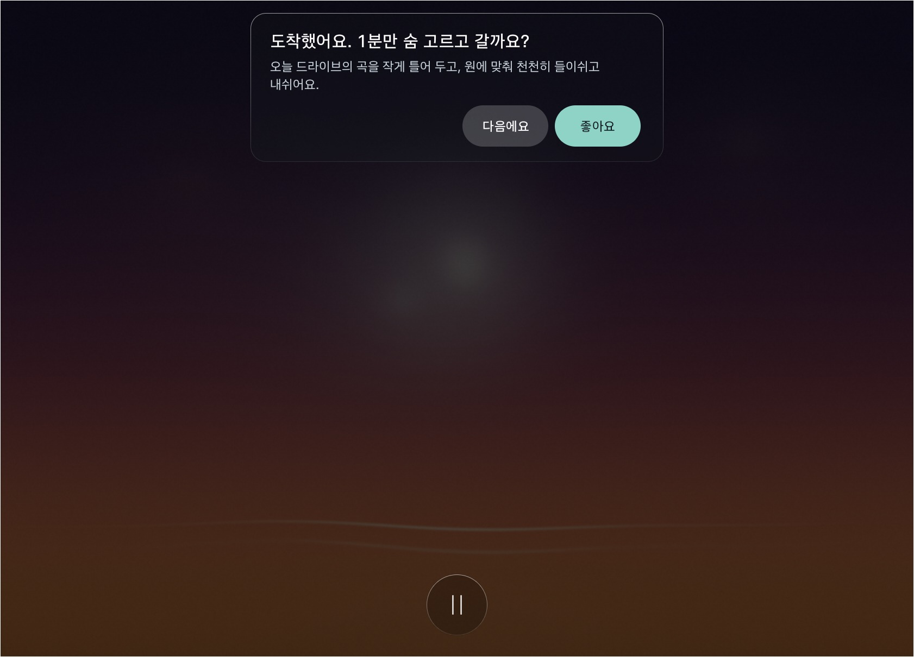

# PlayDrive


**평소처럼 안전하게 운전하면, 그 운전이 실시간으로 한 곡의 음악이 되는 차량용 사운드 앱.**

페달·핸들·방향지시등이 악기가 되고, 부드럽게 운전할수록 연주가 완성됩니다. 급가속·급제동을 하면 음악이 흐트러지고, 다시 부드럽게 달리면 한 마디씩 돌아옵니다. 운전 반응 음악은 대개 가속에 보상하지만, PlayDrive는 **안전에 보상**합니다.

- 플랫폼: Pleos Connect (Android Automotive OS, API 34) · 카테고리: Music/Audio
- APK: [`apk/PlayDrive_v1.0_release.apk`](apk/PlayDrive_v1.0_release.apk)

## 데모 영상

> 준비 중입니다(링크 추가 예정).

## 핵심 장면

| 웰컴: 검은 화면에서 3초 동안 빛이 피어남 | 정차 중(아침 · 비): 빛이 박자에 맞춰 천천히 숨 쉼 | 주행 중: 기본은 정지, 음악 이벤트 때만 한 번 반응 |
|---|---|---|
|  |  |  |
| **정차하는 순간: 지난 구간이 빛 한 겹으로** | **주차 후: 운전자 혼자일 때만 1분 숨 고르기 제안** | **마음 앨범: 주행 1번 = 앨범 1장** |
|  |  |  |

앱 창 영역입니다. 차량 화면 전체(Pleos Connect v2.1.0, 2560×1440)는 `docs/screens/v3/*_full.jpg`에 있습니다.

## 어떻게 동작하나

운전은 음을 **만들지 않고, 고르고 섞기만** 합니다(수직 레이어링 방식의 적응형 음악). 모든 스템은 같은 BPM(90)·조성·코드 진행·마디 길이를 씁니다. 레이어를 켜고 끄는 시점은 다음 박·마디 경계에 맞추기 때문에, 어떤 조합으로 켜져도 불협화음이 나지 않습니다.

| 운전 행동 | 사용하는 신호 | 음악 반응 |
|---|---|---|
| 출발 | 기어 D, 속도 증가 | 다음 다운비트에 드럼·베이스가 함께 들어옴(드롭) |
| 부드러운 가속 | 속도 변화율, 브레이크 | 드럼·퍼커션 추가, 코드톤 아르페지오 |
| 정속 유지 | 속도 | 베이스 → (오래 부드러우면) 멜로디까지 한 겹씩 추가 |
| 부드러운 제동 | 브레이크 페달, 감속도 | 다음 8분음표에 근음+5도 |
| 방향지시등 | TurnSignal | 8분음표 셰이커가 박에 맞춰 합류 |
| 급가속·급제동 | 속도 변화율(약 0.3g) | 테이프스톱·로우패스 효과 후 레이어가 줄어듦 → 부드럽게 달리면 한 마디씩 회복 |
| 급조향 | 조향각 | 멜로디 피치가 잠깐 흔들림 |
| 비 | 와이퍼 | 음악 전체가 젖은 듯 로우패스 + 리버브 |
| 신호 대기 | 속도 0이 2초 이상 | 브레이크다운(드럼·퍼커션 빠짐) |
| 주차 | 기어 P, 착좌 | 패드만 남음 → 운전자 혼자면 1분 호흡 제안 |

화면에도 같은 원칙을 적용했습니다. **운전 중에는 귀로 듣고, 멈추면 눈으로 봅니다.**
- 주행하는 동안 앱은 오늘의 앨범 커버를 그려 두기만 하고 화면에는 반영하지 않습니다. 정차하는 순간 지난 구간이 빛 한 겹으로 더해집니다.
- 커버는 그날 운전으로 그려집니다. 시간대가 바탕색을 정하고, 정차 횟수가 빛의 개수(1~5)를, 부드러움이 빛의 크기와 선명도를 정합니다.
- 비가 온 구간은 커버에 물방울로, 급가속·급제동은 물결이 흐트러진 자국으로 남습니다.
- 주차하면 그 커버가 그대로 마음 앨범의 새 앨범이 됩니다.

## 안전 설계

- **주행 중에는 이벤트 때만 한 번 반응합니다(최소 변화).** Pleos 운전자 주의 분산 가이드(장식적·반복적 움직임 지양, 정보 전달에 필요한 최소한만)를 따릅니다.
  - `CarUxRestrictions`가 `requiresDistractionOptimization`을 요구하는 동안 기본은 정지이며, 다시 그리지도 않습니다. 숨쉬기, 박에 맞춘 밝기 변화, 연속 루프는 없습니다.
  - 음악 이벤트에서만 한 번 전환하고, 그 모습을 유지합니다.

    | 음악 이벤트 | 화면 반응 |
    |---|---|
    | 출발 드롭, 레이어 추가 | 메인 빛 크기 +6%, 밝기 +8%(1.5초) |
    | 레이어 감소 | 반대로(1.5초) |
    | 테이프스톱 | 밝기 −25%(0.7초), 회복하면 원래대로(1.5초) |
    | 와이퍼 ON/OFF | 물방울 페이드 인/아웃(2초) |
  - 전환은 10초에 한 번 이하, 한 번에 2초 이하입니다. 그 사이에 난 이벤트는 합쳐서 다음 전환에 반영합니다.
  - 색, 물결, 커버의 새 겹, 시간대 색은 정차하는 순간 한 번에 반영합니다.
  - 단위 테스트 `MoodSceneTest`가 주행 600초 시뮬레이션으로 이 규칙을 검증합니다. 전환 밖에서는 프레임이 변하지 않고, 간격은 10초 이상, 길이는 2초 이하이며, 이벤트가 없으면 완전히 정지해 있습니다.
- **주행 중 화면에는 단색 무드와 재생/일시정지만 있습니다.** 숫자·점수·글자·알림·자동 스크롤이 없습니다. 마음 앨범, 회고 입력, 1분 호흡, 데모 버튼은 정차 중에만 보이고, 출발하면 바로 닫힙니다.
- **Distraction Optimization 선언**(`distractionOptimized=true`). 차량 화면 기준에 맞춰 터치 영역은 76dp 이상, 본문은 24sp, 제목은 32sp 이상입니다.
- **오디오 정책.**
  - MediaSession과 오디오 포커스를 씁니다.
  - 내비 음성 안내가 나올 때는 시스템이 덕킹합니다.
  - 다른 앱이 포커스를 가져가면 일시정지합니다.
- **표현 원칙.**
  - '게임'처럼 보이는 UI와 용어(점수, 콤보, 순위)를 쓰지 않습니다. 문구는 "연주", "트랙", "하모니"만 씁니다.
  - 호흡 기능은 웰니스 표현("숨 고르기")만 쓰고, 의료 표현(측정·치료)은 쓰지 않습니다.
- **개인정보.**
  - 위치를 저장하지 않습니다.
  - 주행 기록(앨범)은 기기 안에만 저장하며, 서버와 계정이 없습니다.
  - 오디오는 녹음하지 않습니다. 앨범에는 주행 요약과 커버 정보만 저장합니다.
- **신호가 없을 때.** Capability가 없거나 신호를 읽지 못하면 그 신호의 반응만 끄고, 앱은 계속 동작합니다.

## 사용한 Pleos SDK와 권한

- Pleos Vehicle SDK `ai.pleos.playground:Vehicle:2.3.2`(Vehicle State, 읽기 전용)와 AAOS `CarPropertyManager`를 씁니다.
- 신청이 필요한 SDK(TTS, STT, FusedLocation, Vehicle Control)는 쓰지 않습니다.

| 신호 | API | 권한 |
|---|---|---|
| 차량 속도 | `CarPropertyManager` `PERF_VEHICLE_SPEED` | `android.car.permission.CAR_SPEED` |
| 기어 | `CarPropertyManager` `GEAR_SELECTION` | `android.car.permission.CAR_POWERTRAIN` |
| 브레이크 페달 | Vehicle `getBrake()` | `pleos.car.permission.CAR_DRIVE` |
| 조향각 | Vehicle `getSteeringWheel()` | `pleos.car.permission.CAR_DRIVE` |
| 방향지시등 | Vehicle `getTurnSignal()` | `pleos.car.permission.CAR_LIGHTS` |
| 와이퍼 | Vehicle `getWiper()` | `pleos.car.permission.CAR_WINDOWS` |
| 좌석 착좌 | Vehicle `getSeat()` | `pleos.car.permission.CAR_SEATS` |

실제로 쓰는 API의 최소 권한만 선언했고, 모두 읽기 전용입니다.

## 실행 방법

### 1. 에뮬레이터

1. Android Studio SDK Manager > SDK Update Sites에 `https://nexus-playground.pleos.ai/repository/raw-releases/connect-avd/2.x/crp-arm64-sys-img.xml`을 추가합니다.
2. API 34 **Pleos Connect v2.1.0** system image를 설치합니다.
3. Automotive AVD를 만듭니다. 하드웨어 프로필은 Pleos Connect v2.1.0(2560×1440, 160dpi), RAM 4GB, Cold boot입니다.
4. 에뮬레이터를 실행합니다.
   ```bash
   emulator -avd <AVD 이름> -no-snapshot-load -gpu host -timezone Asia/Seoul
   ```
   `-gpu host`를 쓰면 Mac GPU로 그려서 정차 중 화면이 30fps로 움직입니다(에뮬레이터 37.1 기준). 예전 에뮬레이터에서 부팅 직후 멈추면 `-gpu swiftshader_indirect`로 실행하세요.

테스트 환경: Pleos Connect v2.1.0(API 34, arm64), 차량 서비스 2.3.22, 에뮬레이터 37.1.11, Apple M2.

### 2. APK 설치

```bash
adb install -r apk/PlayDrive_v1.0_release.apk
```

앱 목록에서 **PlayDrive**를 실행합니다.
- 처음 실행하면 차량 속도 권한 창이 뜹니다. AAOS에서는 "위치 정보" 권한으로 표시됩니다.
  - **허용**을 누르면 실제 차량(또는 Virtual Console)의 속도에 반응합니다.
  - 허용하지 않아도 데모 드라이브는 동작합니다.
- 음원을 불러오는 데 첫 실행 기준 약 2초가 걸립니다. 그동안 검은 화면에서 빛이 피어나고, 차임과 함께 음악이 시작됩니다.

### 3. 데모 드라이브(74초)

실제 차량 신호 없이 앱의 반응을 처음부터 끝까지 볼 수 있습니다.

- **방법 1(화면)**: 무드 화면 왼쪽 위의 **데모 드라이브** 버튼을 누릅니다. 정차 중에만 보입니다.
- **방법 2(adb)**:
  ```bash
  adb shell am start -n app.playdrive/.MainActivity --es debug demo
  ```

데모는 다음 순서로 차량 신호를 주입합니다.
1. 출발(드롭) → 부드러운 가속(아르페지오) → 정속
2. 방향지시등(셰이커) + 차선 변경 → 부드러운 제동(근음+5도)
3. 신호 대기(브레이크다운) → 재출발
4. 비 → 급제동(테이프스톱) → 회복
5. 정차 → 주차

데모가 끝나면 굿바이(빛이 가라앉음), 1분 숨 고르기 제안, 마음 앨범이 이어집니다. 주행 구간에서는 화면이 멈춰 있고, 정차할 때마다 커버에 빛이 한 겹 더해집니다.

예시 앨범 6장(시간대·날씨·정차 횟수가 서로 다름)을 보려면 아래 명령을 씁니다. 기존 앨범은 지워집니다.
```bash
adb shell am start -n app.playdrive/.MainActivity --es debug seed:albums
```

### 4. 실제 차량 신호(Virtual Console)

```bash
adb forward tcp:8088 tcp:8088   # 그다음 브라우저에서 http://127.0.0.1:8088/
```
Virtual Console에서 속도·기어·브레이크·방향지시등·와이퍼·조향·착좌를 바꾸면 그대로 연주에 반영됩니다.

### 소스에서 빌드

JDK 17과 Android SDK Platform 35가 필요합니다.
```bash
./gradlew :app:testDebugUnitTest   # 단위 테스트
./gradlew assembleDebug            # 디버그 빌드(개발용 패널·화면 바로 열기 명령 포함)
```

- release 빌드는 저장소 밖의 서명 키(`~/.playdrive/keystore.properties`)가 있을 때만 서명됩니다.
- 개발 기록, 측정값, 버전별 화면은 [`docs/dev-notes.md`](docs/dev-notes.md)에 있습니다.

## 음원 출처

- **Suno 유료 플랜(Pro)으로 생성**했으며, 상업적 이용이 가능합니다.
- 기본 음원은 Suno로 만든 90 BPM 로파이 곡 한 곡입니다.
  - 악기별 스템(drums, bass, keys, guitar, synth, perc)으로 분리했습니다.
  - 모든 스템을 같은 8마디 구간으로 잘라 `app/src/main/res/raw/song_*.ogg`로 넣었습니다.
- 보조 음원 `lofi_*.ogg`는 스템별 4마디 루프와 효과음(테이프스톱, 스크래치) 원샷입니다.
- 반응형 연주음(로즈풍 FM 음, 셰이커)과 웰컴 차임은 앱 안에서 코드로 합성합니다. 외부 음원은 쓰지 않습니다.
- 분석·가공 스크립트는 `tools/analyze_song.py`, `tools/process_stems.py`, `tools/find_tapestop.py`입니다. 원본 WAV는 저장소에 포함하지 않습니다.

## 라이선스

- 소스 코드와 음원: 공모전 심사를 위해 공개합니다. 별도 표기 전까지 모든 권리를 보유합니다(All rights reserved).
- 사용한 라이브러리:
  - AndroidX와 Jetpack Compose(Apache License 2.0)
  - Pleos Vehicle SDK(Pleos Playground 이용 약관)
