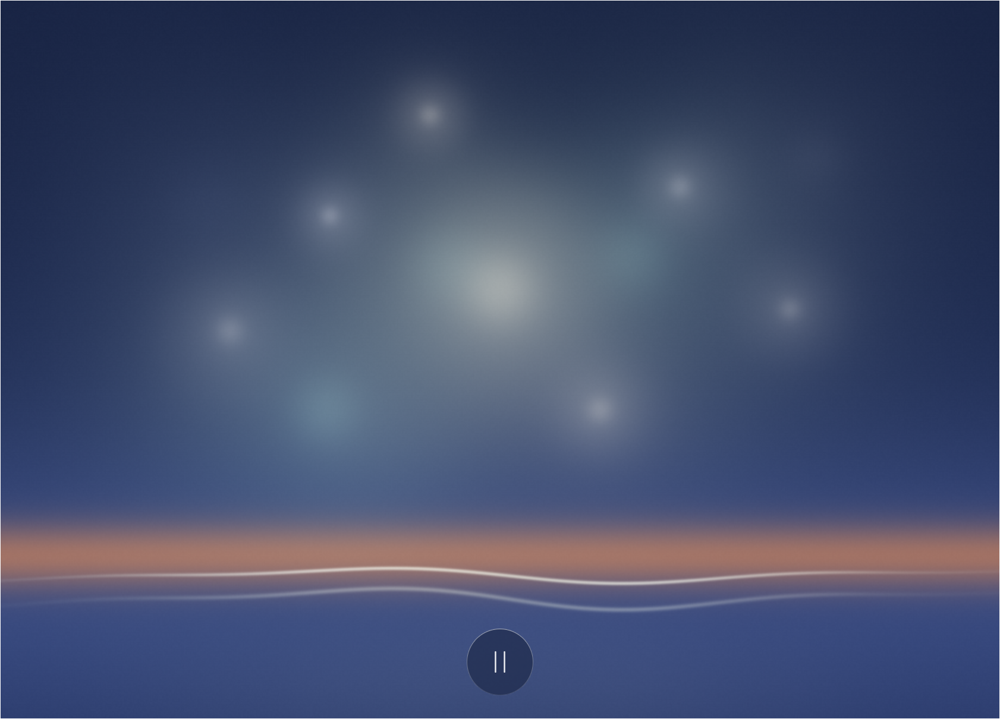
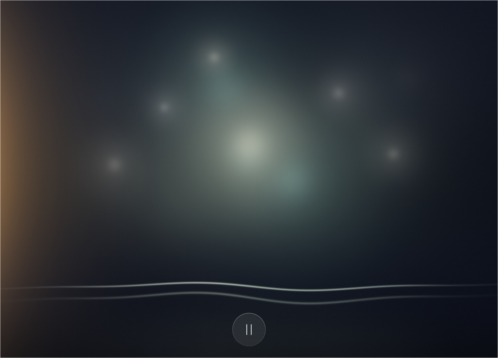
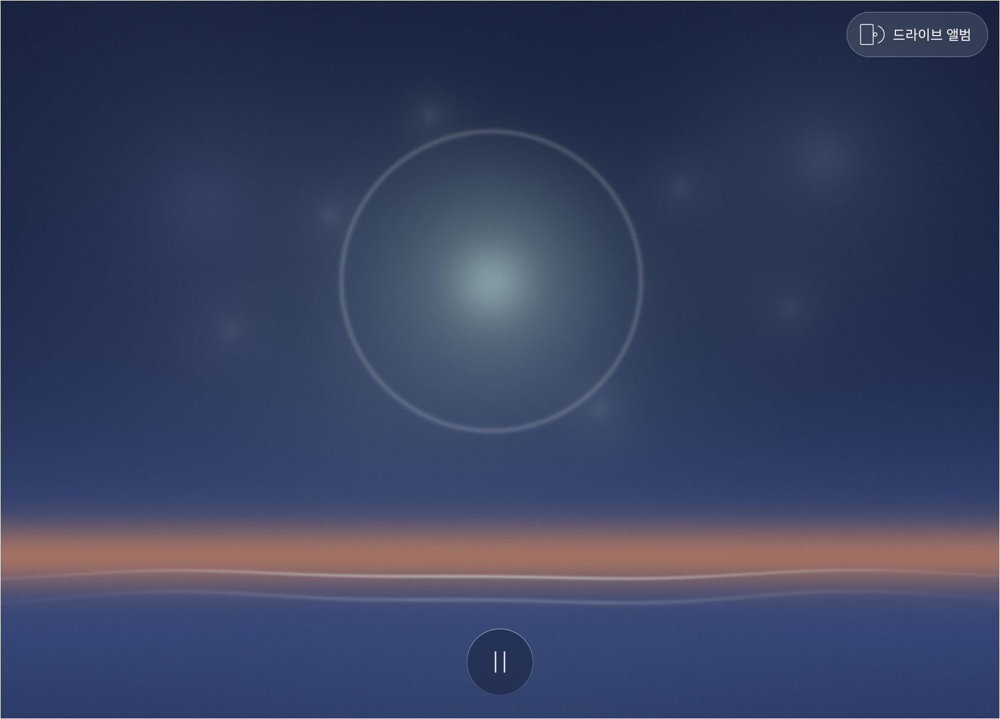
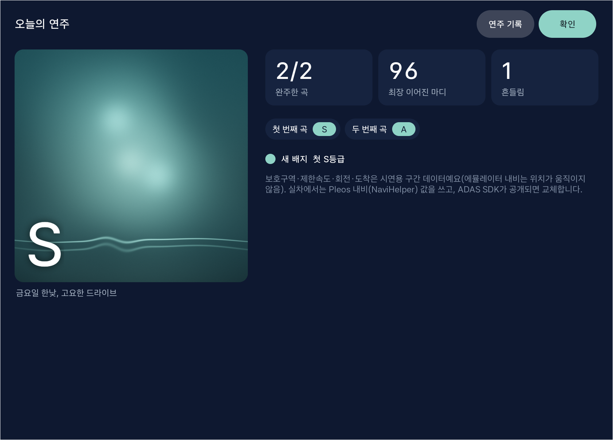
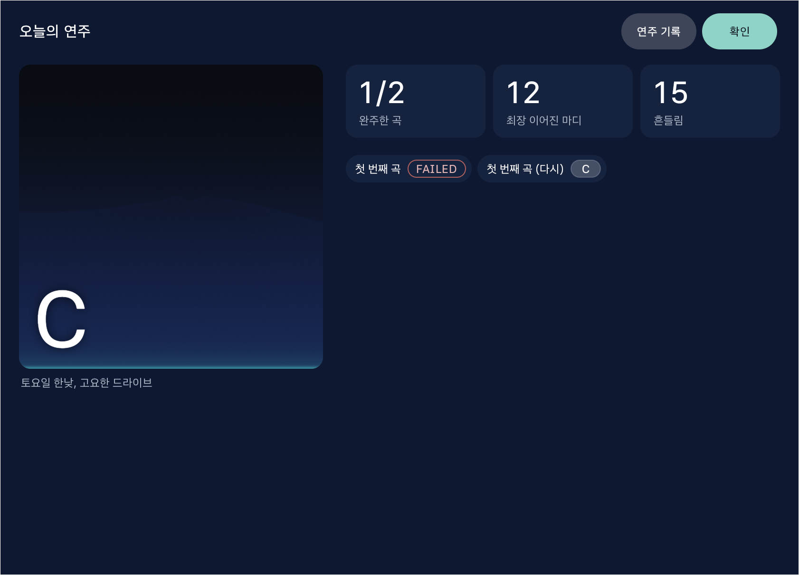
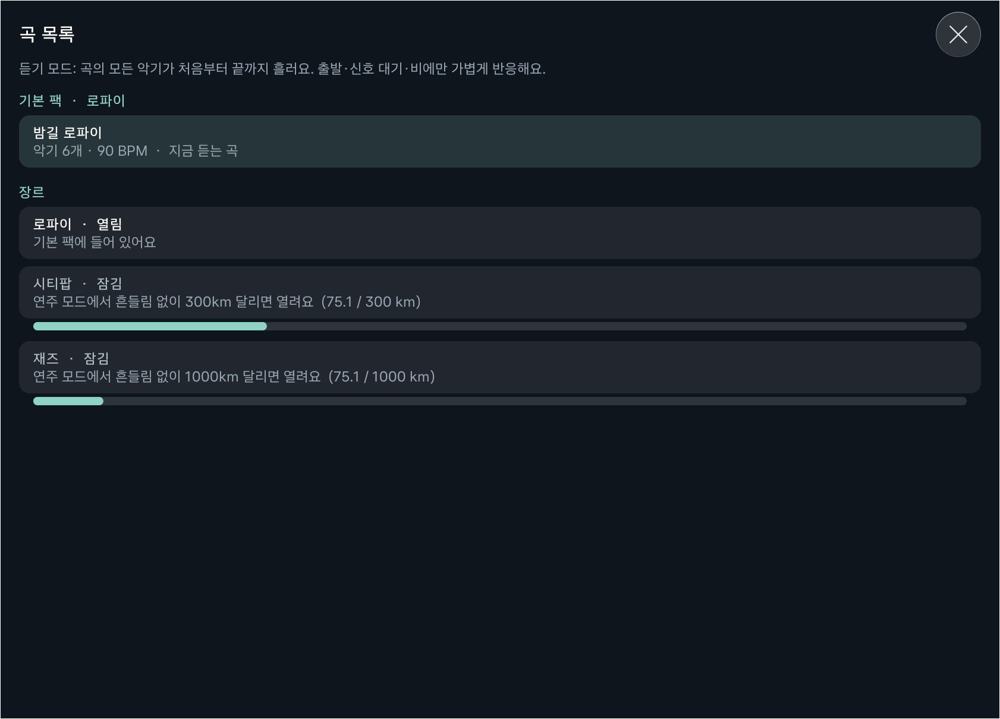
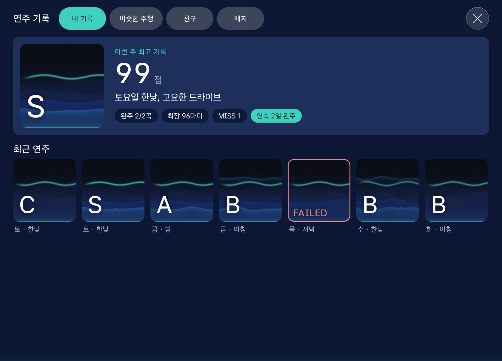
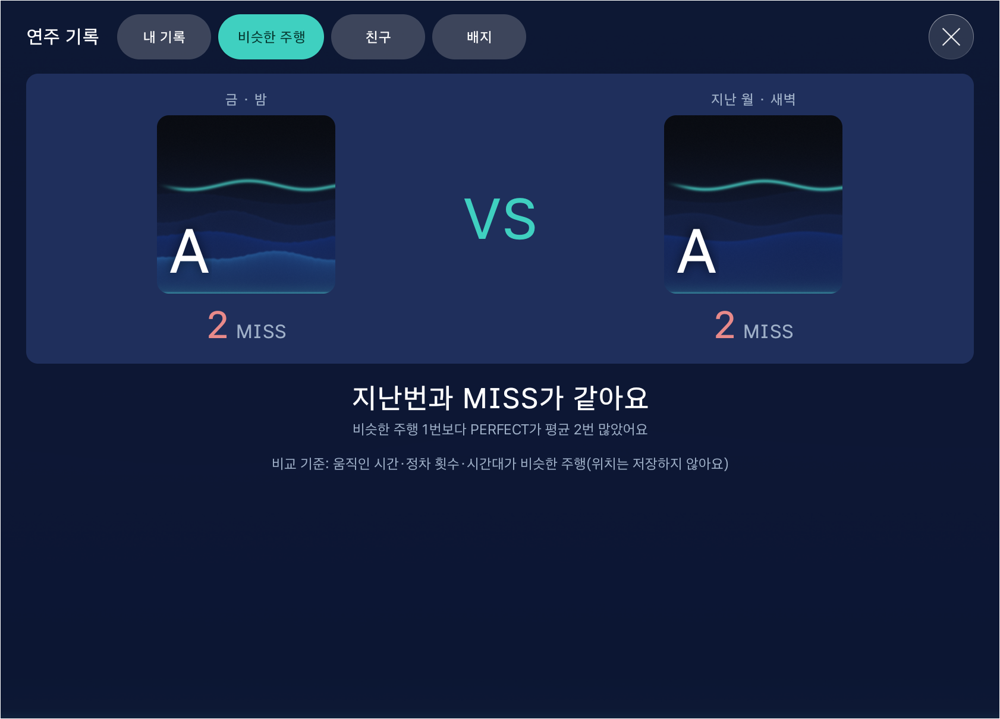
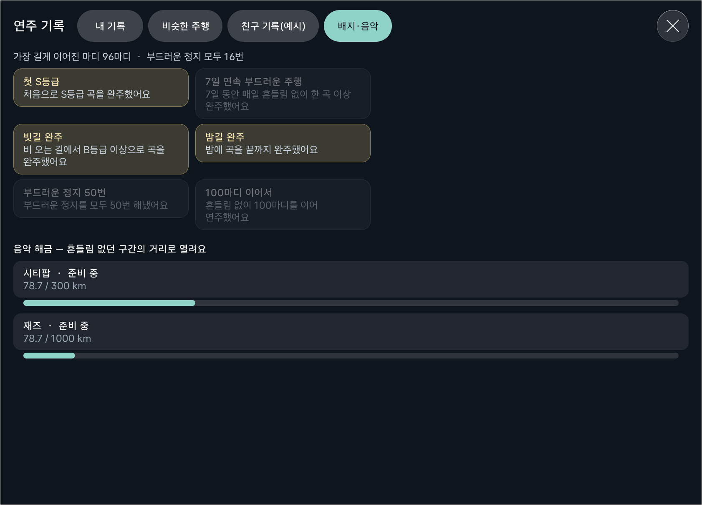

# PlayDrive


**평소처럼 안전하게 운전하면, 그 운전이 실시간으로 한 곡의 음악이 되는 차량용 사운드 앱.**

페달·핸들·방향지시등이 악기가 되고, 부드럽게 운전할수록 연주가 완성됩니다. 급가속·급제동을 하면 음악이 흐트러지고, 다시 부드럽게 달리면 한 마디씩 돌아옵니다. 운전 반응 음악은 대개 가속에 보상하지만, PlayDrive는 **안전에 보상**합니다.

- 플랫폼: Pleos Connect (Android Automotive OS, API 34) · 카테고리: Music/Audio
- APK: [`apk/플레이드라이브_PlayDrive_release.apk`](apk/플레이드라이브_PlayDrive_release.apk)

## 데모 영상

> 준비 중입니다(링크 추가 예정).

## 핵심 장면

| 주행 중(노을): 물결 한 줄 = 악기 하나 | 주행 중(밤): 멜로디 리본·청록 앰비언트 선 | 신호 대기: 패드·코드 물결만 잔잔하게 |
|---|---|---|
|  |  |  |
| **주차하면: 오늘의 연주(CLEARED → 등급)** | **MISS가 많았던 날: FAILED 뒤 RETRY CLEAR** | **듣기 모드: 곡 목록·장르 해금** |
|  |  |  |
| **연주 기록: 이번 주 최고 기록** | **비슷한 주행: 오늘 VS 지난번** | **배지·음악 해금** |
|  |  |  |

시연 영상: `docs/screens/v4/demo_safe.mp4`(노을), `demo_rough.mp4`(밤) — 용량 때문에 저장소에는 올리지 않습니다.
앱 창 영역입니다. 차량 화면 전체(Pleos Connect, 2560×1440)는 `docs/screens/v4/full/`, 세로 보조 패널(1:1.6)은 `docs/screens/v4/panel/`에 있습니다. 창 비율 전환은 `full/12_window_1to1_resize.png`, `13_window_1to2_resize.png`(에뮬레이터에서 `am task resize`로 바꾼 창).

## 어떻게 동작하나

운전은 음을 **만들지 않고, 고르고 섞기만** 합니다(수직 레이어링 방식의 적응형 음악). 모든 스템은 같은 BPM(90)·조성·코드 진행·마디 길이를 씁니다. 레이어를 켜고 끄는 시점은 다음 박·마디 경계에 맞추기 때문에, 어떤 조합으로 켜져도 불협화음이 나지 않습니다.

| 운전 행동 | 사용하는 신호 | 음악 반응 |
|---|---|---|
| 출발 | 기어 D, 속도 증가 | 다음 다운비트에 드럼·베이스가 함께 들어옴(드롭) |
| 부드러운 가속 | 속도 변화율, 브레이크 | 드럼·퍼커션 추가, 코드톤 아르페지오 |
| 정속 유지 | 속도 | 베이스 → (오래 부드러우면) 멜로디까지 한 겹씩 추가 |
| 부드러운 제동 | 브레이크 페달, 감속도 | 다음 8분음표에 근음+5도 |
| 방향지시등 | TurnSignal | 8분음표 셰이커가 박에 맞춰 합류 |
| 급가속·급제동 | 속도 변화율(약 0.3g) | 테이프스톱·로우패스 효과 후 레이어가 줄어듦 → 부드럽게 달리면 한 마디씩 회복 |
| 급조향 | 조향각 | 멜로디 피치가 잠깐 흔들림 |
| 비 | 와이퍼 | 음악 전체가 젖은 듯 로우패스 + 리버브 |
| 신호 대기 | 속도 0이 2초 이상 | 브레이크다운(드럼·퍼커션 빠짐) |
| 주차 | 기어 P | 패드만 남음 → 바로 오늘의 연주(결과) |

화면에도 같은 원칙을 적용했습니다. **운전 중에는 귀로 듣고, 멈추면 눈으로 봅니다.**
- 주행하는 동안 앱은 오늘의 앨범 커버를 그려 두기만 하고 화면에는 반영하지 않습니다. 정차하는 순간 지난 구간이 빛 한 겹으로 더해집니다.
- 커버는 그날 운전으로 그려집니다. 시간대가 바탕색을 정하고, 정차 횟수가 빛의 개수(1~5)를, 부드러움이 빛의 크기와 선명도를 정합니다.
- 비가 온 구간은 커버에 물방울로, 급가속·급제동은 물결이 흐트러진 자국으로 남습니다.
- 주차하면 그 커버가 그대로 드라이브 앨범의 새 앨범이 됩니다.

## 연주 기록: 곡과 라이프 게이지

주행은 **곡(스테이지) 단위**로 연주됩니다. 한 곡은 64마디(약 2분 50초)이고, 끝까지 악기가 남아 있으면 완주하고 다음 곡으로 넘어갑니다. 하루 횟수 제한은 없습니다. **속도·시간·거리에는 보상하지 않고 부드러움에만 보상합니다.** 결과·기록 화면은 리듬게임 결과 화면처럼 보여 주고, 판정은 **PERFECT**, 흔들림은 **MISS**라고 씁니다(콤보 대신 "이어진 마디").

- **라이프 게이지 = 남은 악기 수(0~6).** 곡은 악기 4개로 시작합니다.
  - MISS(흔들림)가 생기면 악기가 다음 박에 빠집니다: 급가속·급조향·깜빡이 없는 회전·제한속도 5초 넘게 초과는 −1, 급제동은 −2.
  - MISS 없이 4마디가 지날 때마다 +1(최대 6)이고, PERFECT가 나오면 바로 +1입니다.
  - 출발 후 8마디는 워밍업이라 1개 밑으로 내려가지 않습니다.
- **악기가 1개 남으면** 소리가 먹먹해지고 "조금만 부드럽게요"라고 말합니다(곡당 1번).
- **0개가 되면** 테이프스톱으로 연주가 멈추고, 잔잔한 패드만 낮게 깔린 채 "연주가 멈췄어요. 부드럽게 달리면 다시 시작할게요."라고 말합니다.
  MISS 없이 15초를 달리거나, 정차했다가 다시 출발하면 "다시 시작할게요" → 4박 카운트인 → 같은 곡을 처음부터 악기 3개로 다시 연주합니다. 화면은 누르지 않아도 됩니다.
- **이어진 마디**(게이지와 별개, MISS면 0): 16마디마다 필인, 32마디에 로즈 아르페지오 합류, 48마디에 클라이맥스.
- **PERFECT와 소리 보상**(모두 그 순간의 코드에 맞춤):

| PERFECT | 조건 | 소리 |
|---|---|---|
| 출발 | 출발 5초 동안 가속 0.15g 이하 | 드롭 강화 |
| 차선 변경 | 깜빡이 3초 이상 → 급조향 없이 | 심벌 스웰 |
| 정지 | 멈출 때까지 감속 0.2g 이하 | 마무리 화음 |
| 회전(내비) | 다음 회전 300m 안에서 그 방향 깜빡이 + 급조향 없이 회전 | 심벌 스웰 |
| 보호구역(내비) | 어린이 보호구역을 나올 때까지 제한속도 준수 | 드롭 강화 |

- **곡 점수** = 평균 남은 악기 비율 × 70 + 곡 안 최장 이어진 마디/64 × 20 + PERFECT 보너스(하나마다 2, 최대 10). 등급은 S 90 이상 / A 80 / B 70 / C 완주 / FAILED입니다. 곡 안의 값만 쓰므로, 같은 부드러움이면 빨리 달려도 오래 달려도 곡 점수가 같습니다(단위 테스트 `PlayTrackerTest`).
- **오늘의 연주**(P로 주차하면, 정차 중에만): 화면 정가운데에 **CLEARED / RETRY CLEAR / FAILED**가 크게 뜬 뒤 왼쪽 위로 옮겨 가고, 숫자 카드(완주 곡, 최장 마디, MISS)가 0부터 차오르고, 마지막에 등급이 커버 위에 도장 찍듯 나옵니다(2.5초 안, 누르면 바로 끝 모습). S등급이면 뒤의 물결이 한 번 밝게 차오르고, 2초에 결과 음성이 나옵니다.
  곡별 결과는 가로 카드(곡 번호·큰 등급·그 곡 점, FAILED는 붉은 테두리, 다시 도전한 곡은 RETRY), 새 배지는 메달 카드. "자세히"에서 종류별 PERFECT와 MISS의 뜻을 봅니다. 뒤에는 그날의 물결이 비칩니다(등급이 높을수록 더).
- **연주 기록**(정차 중): 내 기록(이번 주 최고 기록 카드 + 최근 연주 커버 카드), 비슷한 주행(오늘 VS 지난 비슷한 주행 — 위치를 저장하지 않으므로 움직인 시간·정차 횟수·시간대로 고름), 친구(예시 데이터, 상위 3명 단상), 배지(메달 + 진행 막대)·음악 해금(MISS 없이 달린 거리로 시티팝 300km·재즈 1,000km).
- **주행 중 화면**에는 여전히 글자·숫자가 없습니다. 물결 줄 수가 남은 악기 수를 따라가고, 연주가 멈추면 평평한 선으로 누웠다가 카운트인 4박 뒤 곡이 다시 열리면 일어납니다.

### 내비 연동(Pleos NaviHelper)

- 안내가 시작되면(`onRouteStarted`) 카운트인 뒤 첫 곡이 시작됩니다. 목적지까지 1km 안(`onDrivingInfo`)이면 마지막 구간 클라이맥스가 나오고, 도착하면(`onDestinationArrived`) 연주 중이던 곡을 마무리합니다(16마디 이상일 때).
- 회전 판정은 `onTBTInfo`, 제한속도·보호구역은 `onCurrentRoadSpeedLimit`·`CameraAlert`(SCHOOL_ZONE)·`CautionPoint`(SCHOOL_ZONE)를 씁니다.
- **에뮬레이터 한계:** Pleos 에뮬레이터 내비는 경로 요청·회전 목록까지는 응답합니다. 하지만 위치가 움직이지 않아(GPS 주입 무시, 모의 주행 API 없음) 회전 거리·도착·제한속도가 바뀌지 않습니다. 그래서 `demo:safe`는 **시연용 구간 데이터**(제한 50 → 보호구역 30 → 50, 우회전 1번, 도착)를 씁니다. 결과 화면에도 그렇게 표시하고, 실차에서는 NaviHelper 값을 씁니다(ADAS SDK가 공개되면 교체).

### 음성 안내

- **Pleos TTS**(`TextToSpeech` 3.3.1, ON_DEVICE)로 먼저 읽고, 실패하면 미리 녹음한 음성(`res/raw/voice_*.ogg`)으로 대신합니다.
- 주행 중에는 운전과 관련된 세 문장만 말합니다(조금만 부드럽게요 / 연주가 멈췄어요… / 다시 시작할게요). 같은 문장은 60초 안에 반복하지 않습니다.
- 주차 후에는 최고 등급과 그 곡의 점, 이번 주 최고 기록, 새 배지를 말합니다.
- 말하는 동안 음악은 −12dB로 낮아지고, 끝나면 1초에 걸쳐 돌아옵니다. 설정에서 끌 수 있습니다(기본 켜짐).

## 안전 설계

- **주행 화면 = 흐르는 그라데이션 물결.** 물결 한 줄이 악기 하나이고(남은 악기 수와 1:1), 지금 들리는 소리로 움직입니다.
  - 앱이 재생하는 스템을 분석한 악보(`res/raw/wave_score.txt`, `tools/make_wave_score.py`)를 들리는 위치(AudioTrack 타임스탬프로 출력 지연을 뺀 위치)에서 읽습니다.
    - 킥: 바닥 가운데서 좌우로 번지는 파동. 스네어: 한쪽에서 얕게.
    - 베이스: 음 높이에 맞춰 물결 높이가 바뀌고, 칠 때마다 부풂.
    - 코드: 바뀔 때 색과 모양이 새로 잡힘. 하이햇: 맨 위 물결의 고운 결.
    - 멜로디: 음 높이를 따라 오르내리는 포인트 색 리본.
  - 박자 파동은 악보를 80ms 미리 읽어 정점이 박자에 오게 차오르고, 약 0.8초에 걸쳐 풀립니다. 모든 값은 임계감쇠 스프링으로 움직여 한 프레임에 튀지 않습니다(60fps).
  - 곡이 진행될수록(64마디) 물결이 높아지고 색이 깊어집니다. 필인·판정 보상은 소리가 나는 순간 해당 물결이 한 번 더 크게 반응합니다.
  - 정차하면 패드·코드만 아주 느리게, 테이프 스톱이면 느려지며 아래로 처집니다. 위험(악기 1개)이면 낮고 바래고, FAILED면 평평한 선으로 눕고 어두워집니다. 카운트인 4박에 파동 4번이 점점 커진 뒤 다시 일어납니다.
  - 빛 방울·입자·링·반짝임은 없습니다. 바닥에는 대시보드 앰비언트 라인과 이어지는 청록 선이 있습니다.
- **화면 효과는 설정에서 고릅니다**(정차 중에만, 다음 출발부터): 라이브(기본, 박자 파동·보상 반응) / 차분(악기별 물결이 들어오고 빠지는 것만, 박자 파동 없음).
  - **운전 방해 기준:** 화면 밝기 변화 초당 10% 이내, 3Hz 이상 깜빡임 없음(타격은 모양만 움직임), 흐름 한 주기 20초 이상, 글자·숫자 없음.
  - `WaveMotionTest`가 600초 시뮬레이션으로 밝기 변화·프레임별 물결 높이 변화량(튐)을 검사합니다. 녹화 영상은 `tools/check_luma.py`(실제 화면 밝기), 기기 로그는 `tools/check_wave_log.py`(프레임별 높이)로 다시 확인합니다.
- **연주 / 듣기 모드.** 첫 화면(정차 중)에서 고르고, 마지막 선택을 기억합니다. 주행 중에는 바꿀 수 없습니다.
  - 듣기 모드는 게이지·판정·FAILED·등급·연주 기록·게임 음성이 없고, 곡의 악기 6개가 처음부터 끝까지 흐릅니다. 출발·신호 대기·와이퍼에만 가볍게 반응하고, 흔들림에는 반응하지 않습니다. 주차하면 결과 대신 드라이브 앨범에 커버만 남습니다.
  - 곡 목록(정차 중): 팩 단위(팩 이름·장르·곡·스템)로 구성했고 지금은 기본 팩 1개입니다. 잠긴 장르는 연주 모드에서 흔들림 없이 달린 거리로 열립니다.
- **Pleos 창 정책(1:1, 2:1, 1:2) 대응, 창 비율에 따라 레이아웃 자동 전환.** 창 크기가 바뀌어도 앱을 다시 만들지 않아 음악·물결이 이어지고, 가로:세로 < 1이면 세로 패널 레이아웃으로 결과·기록·앨범·곡 목록을 다시 그립니다.
- **주행 중 화면에는 무드 화면과 재생/일시정지만 있습니다.** 숫자·점수·글자·알림·자동 스크롤이 없습니다. 결과·연주 기록·드라이브 앨범·설정·데모 버튼은 정차 중에만 보이고, 출발하면 바로 닫힙니다.
- **Distraction Optimization 선언**(`distractionOptimized=true`). 차량 화면 기준에 맞춰 터치 영역은 76dp 이상, 본문은 24sp, 제목은 32sp 이상입니다.
- **오디오 정책.**
  - MediaSession과 오디오 포커스를 씁니다.
  - 내비 음성 안내가 나올 때는 시스템이 덕킹합니다.
  - 다른 앱이 포커스를 가져가면 일시정지합니다.
- **표현 원칙.**
  - '게임'처럼 보이는 UI와 용어(점수, 콤보, 순위)를 쓰지 않습니다. 문구는 "연주", "트랙", "하모니"만 씁니다.
- **개인정보.**
  - 위치를 저장하지 않습니다.
  - 주행 기록(앨범)은 기기 안에만 저장하며, 서버와 계정이 없습니다.
  - 오디오는 녹음하지 않습니다. 앨범에는 주행 요약과 커버 정보만 저장합니다.
- **신호가 없을 때.** Capability가 없거나 신호를 읽지 못하면 그 신호의 반응만 끄고, 앱은 계속 동작합니다.

## 사용한 Pleos SDK와 권한

- **Vehicle** `ai.pleos.playground:Vehicle:2.3.2`(Vehicle State, 읽기 전용), **NaviHelper** `ai.pleos.playground:NaviHelper:3.0.5`, **TextToSpeech** `ai.pleos.playground:TextToSpeech:3.3.1`(ON_DEVICE)과 AAOS `CarPropertyManager`를 씁니다.
- STT, FusedLocation, Vehicle Control은 쓰지 않습니다. TTS는 공개 문서에 아직 "Coming Soon"으로 되어 있습니다. 에뮬레이터에서 동작을 확인했고, 쓸 수 없으면 녹음 음성으로 대신합니다.

| 신호 | API | 권한 |
|---|---|---|
| 차량 속도 | `CarPropertyManager` `PERF_VEHICLE_SPEED` | `android.car.permission.CAR_SPEED` |
| 기어 | `CarPropertyManager` `GEAR_SELECTION` | `android.car.permission.CAR_POWERTRAIN` |
| 브레이크 페달 | Vehicle `getBrake()` | `pleos.car.permission.CAR_DRIVE` |
| 조향각 | Vehicle `getSteeringWheel()` | `pleos.car.permission.CAR_DRIVE` |
| 방향지시등 | Vehicle `getTurnSignal()` | `pleos.car.permission.CAR_LIGHTS` |
| 와이퍼 | Vehicle `getWiper()` | `pleos.car.permission.CAR_WINDOWS` |
| 좌석 착좌 | Vehicle `getSeat()` | `pleos.car.permission.CAR_SEATS` |
| 회전 안내·남은 거리·도착·제한속도·보호구역 | NaviHelper `onTBTInfo` `onDrivingInfo` `onDestinationArrived` `onCurrentRoadSpeedLimit` `onCameraAlert` `onCautionPointInfo` | `pleos.car.permission.NAVI_ROUTE`, `NAVI_ROUTE_SEARCH` |
| 음성 안내 | TextToSpeech `speak`(ON_DEVICE) | `pleos.car.permission.TTS_SERVICE` |

실제로 쓰는 API의 최소 권한만 선언했습니다. 차량 신호와 내비는 읽기만 합니다. 모든 권한은 normal 등급이라 설치하면 허용되고, 차량 속도만 실행할 때 허락을 받습니다.

## 실행 방법

### 1. 에뮬레이터

1. Android Studio SDK Manager > SDK Update Sites에 `https://nexus-playground.pleos.ai/repository/raw-releases/connect-avd/2.x/crp-arm64-sys-img.xml`을 추가합니다.
2. API 34 **Pleos Connect v2.1.0** system image를 설치합니다.
3. Automotive AVD를 만듭니다. 하드웨어 프로필은 Pleos Connect v2.1.0(2560×1440, 160dpi), RAM 4GB, Cold boot입니다.
4. 에뮬레이터를 실행합니다.
   ```bash
   emulator -avd <AVD 이름> -no-snapshot-load -gpu host -timezone Asia/Seoul
   ```
   `-gpu host`를 쓰면 Mac GPU로 그려서 정차 중 화면이 30fps로 움직입니다(에뮬레이터 37.1 기준). 예전 에뮬레이터에서 부팅 직후 멈추면 `-gpu swiftshader_indirect`로 실행하세요.

테스트 환경: Pleos Connect v2.1.0(API 34, arm64), 차량 서비스 2.3.22, 에뮬레이터 37.1.11, Apple M2.

### 2. APK 설치

```bash
adb install -r apk/플레이드라이브_PlayDrive_release.apk
```

앱 목록에서 **PlayDrive**를 실행합니다.
- 처음 실행하면 차량 속도 권한 창이 뜹니다. AAOS에서는 "위치 정보" 권한으로 표시됩니다.
  - **허용**을 누르면 실제 차량(또는 Virtual Console)의 속도에 반응합니다.
  - 허용하지 않아도 데모 드라이브는 동작합니다.
- 음원을 불러오는 데 첫 실행 기준 약 2초가 걸립니다. 그동안 검은 화면에서 빛이 피어나고, 차임과 함께 음악이 시작됩니다.

### 3. 데모 드라이브(74초)

실제 차량 신호 없이 앱의 반응을 처음부터 끝까지 볼 수 있습니다.

- **방법 1(화면)**: 무드 화면 왼쪽 위의 **데모 드라이브** 버튼을 누릅니다. 정차 중에만 보입니다.
- **방법 2(adb)**:
  ```bash
  adb shell am start -n app.playdrive/.MainActivity --es debug demo
  ```

데모는 다음 순서로 차량 신호를 주입합니다.
1. 출발(드롭) → 부드러운 가속(아르페지오) → 정속
2. 방향지시등(셰이커) + 차선 변경 → 부드러운 제동(근음+5도)
3. 신호 대기(브레이크다운) → 재출발
4. 비 → 급제동(테이프스톱) → 회복
5. 정차 → 주차

데모가 끝나면(주차) 바로 오늘의 연주 결과가 나오고, 확인을 누르면 드라이브 앨범으로 갑니다. 주행 구간에서는 화면이 멈춰 있고, 정차할 때마다 커버에 빛이 한 겹 더해집니다.

예시 앨범 6장(시간대·날씨·정차 횟수가 서로 다름)을 보려면 아래 명령을 씁니다. 기존 앨범은 지워집니다.
```bash
adb shell am start -n app.playdrive/.MainActivity --es debug seed:albums
```

### 3-1. 연주 기록 데모(demo:safe / demo:rough)

```bash
# 예시 앨범·예시 연주 기록(이전 6번의 주행)을 만든 뒤 시작
adb shell am start -n app.playdrive/.MainActivity --es debug "'seed:albums;seed:play;demo:safe'"
adb shell am start -n app.playdrive/.MainActivity --es debug demo:rough
```
- `demo:safe`(6분, 내비 안내 모드): 안내 시작 → 카운트인 → 출발 → 차선 변경·깔끔한 회전 → 첫 곡 완주(S) → 보호구역 통과 → 급제동 한 번 → 마지막 1km 클라이맥스 → 두 번째 곡 완주(A) → 도착 → 결과(완주 2/2곡, 새 배지 '첫 S등급').
- `demo:rough`(4분): 급가속·급조향·급제동 → 악기가 빠지고 "조금만 부드럽게요" → 연주 정지 → 15초 부드럽게 → "다시 시작할게요" + 카운트인 → 같은 곡을 다시 완주(C) → 결과(완주 1/2곡).
- 화면·영상: `docs/screens/v4/`(`tools/capture_v4.sh`). 영상 파일(mp4)은 저장소에 올리지 않습니다.

### 4. 실제 차량 신호(Virtual Console)

```bash
adb forward tcp:8088 tcp:8088   # 그다음 브라우저에서 http://127.0.0.1:8088/
```
Virtual Console에서 속도·기어·브레이크·방향지시등·와이퍼·조향·착좌를 바꾸면 그대로 연주에 반영됩니다.

### 소스에서 빌드

JDK 17과 Android SDK Platform 35가 필요합니다.
```bash
./gradlew :app:testDebugUnitTest   # 단위 테스트
./gradlew assembleDebug            # 디버그 빌드(개발용 패널·화면 바로 열기 명령 포함)
```

- release 빌드는 저장소 밖의 서명 키(`~/.playdrive/keystore.properties`)가 있을 때만 서명됩니다.
- 개발 기록, 측정값, 버전별 화면은 [`docs/dev-notes.md`](docs/dev-notes.md)에 있습니다.

## 음원 출처

- **Suno 유료 플랜(Pro)으로 생성**했으며, 상업적 이용이 가능합니다.
- 기본 음원은 Suno로 만든 90 BPM 로파이 곡 한 곡입니다.
  - 악기별 스템(drums, bass, keys, guitar, synth, perc)으로 분리했습니다.
  - 모든 스템을 같은 8마디 구간으로 잘라 `app/src/main/res/raw/song_*.ogg`로 넣었습니다.
- 보조 음원 `lofi_*.ogg`는 스템별 4마디 루프와 효과음(테이프스톱, 스크래치) 원샷입니다.
- 반응형 연주음(로즈풍 FM 음, 셰이커)과 웰컴 차임, 연주 기록 보상음(붐·심벌·스웰·마무리 화음)은 앱 안에서 코드로 합성합니다. 외부 음원은 쓰지 않습니다.
- 음성 안내는 Pleos TTS가 먼저 읽습니다. 대신 쓰는 녹음 음성 `voice_*.ogg`(111개)는 macOS 기본 한국어 음성(Yuna, `say`)으로 만든 **임시 음성**입니다(이전 eSpeak NG 음성이 기계음처럼 들려 교체). macOS 사용권은 시스템 음성 출력을 개인·비상업 용도로만 허락하므로, 정식 출시 전에는 상업 이용이 가능한 음성(성우 녹음 또는 상용 TTS)으로 바꿉니다. `tools/make_voice.py`로 다시 만들 수 있고, 같은 파일 이름으로 바꾸면 목소리가 바뀝니다. 시연 영상은 앱 소리를 그대로 저장해 만들기 때문에(TTS 소리는 앱 밖으로 나감) 녹음 음성으로 녹화했습니다.
- 분석·가공 스크립트는 `tools/analyze_song.py`, `tools/process_stems.py`, `tools/find_tapestop.py`입니다. 원본 WAV는 저장소에 포함하지 않습니다.

## 라이선스

- 소스 코드와 음원: 공모전 심사를 위해 공개합니다. 별도 표기 전까지 모든 권리를 보유합니다(All rights reserved).
- 사용한 라이브러리:
  - AndroidX와 Jetpack Compose(Apache License 2.0)
  - Pleos Vehicle SDK(Pleos Playground 이용 약관)
